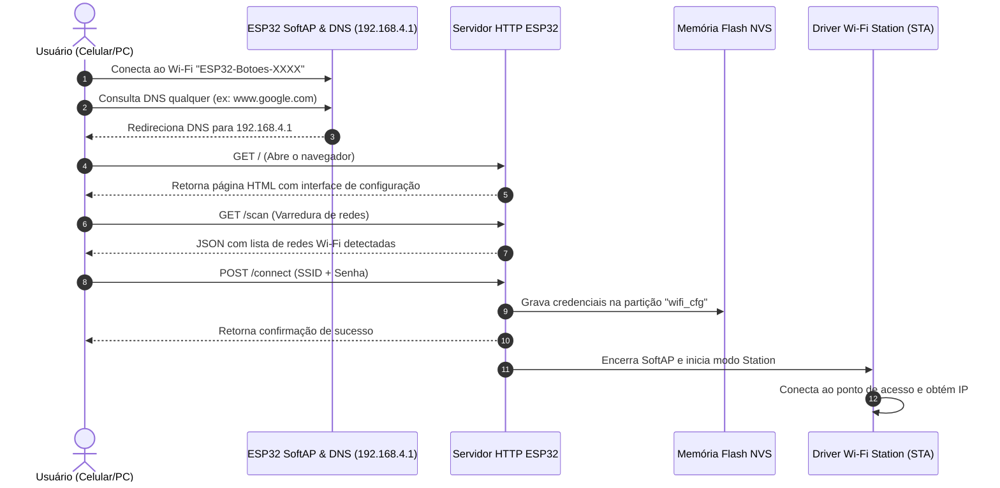
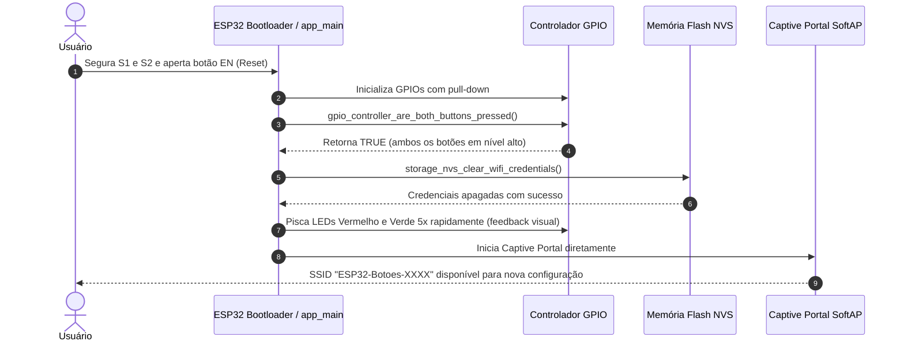
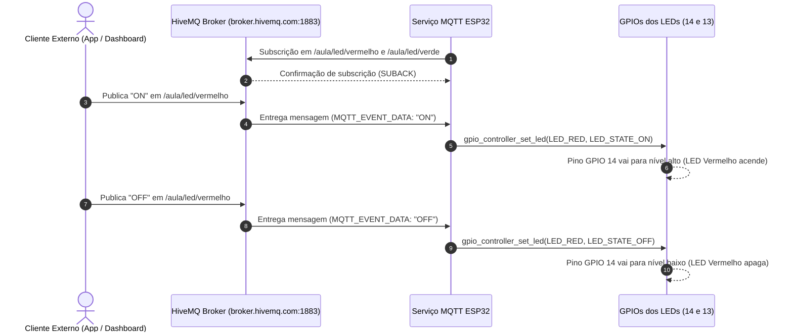
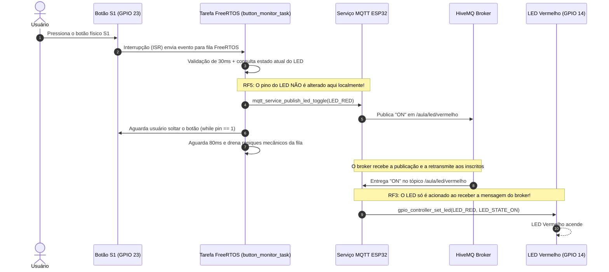

# Botoes-MQTT: Controle e Telemetria com ESP32 e ESP-IDF v6.1

Sistema embarcado de alta confiabilidade desenvolvido para o microcontrolador **ESP32 DevKit v1** utilizando o framework oficial **ESP-IDF v6.1**. O projeto integra controle de periféricos (LEDs e botões com debounce assíncrono), provisionamento dinâmico de rede sem fio (**Captive Portal Web**) com persistência em memória flash (**NVS**), rotina de redefinição de fábrica de rede via botões no boot e mensageria bidirecional via protocolo **MQTT**.

---

## 1. Características do Sistema

- **Framework:** ESP-IDF v6.1 com suporte ao componente gerenciado `espressif/mqtt`.
- **Arquitetura Modular:** Separação estrita de responsabilidades em módulos desacoplados com event loops e filas FreeRTOS.
- **Provisionamento Wi-Fi Autônomo:**
  - SoftAP com SSID dinâmico baseado no endereço MAC físico: `ESP32-Botoes-XXXX`.
  - Servidor DNS UDP (porta 53) redirecionando todo o tráfego HTTP para o IP `192.168.4.1`.
  - Servidor Web HTTP com varredura assíncrona de redes Wi-Fi locais (`/scan`) e persistência segura na NVS (`/connect`).
  - Máquina de estados resiliente: reconexão automática em até 3 tentativas com intervalos de 5 segundos antes de retornar ao Captive Portal.
- **Factory Reset de Rede no Boot:** Ao inicializar a placa mantendo ambos os botões pressionados, as credenciais da NVS são apagadas e o Captive Portal é aberto imediatamente.
- **Mensageria MQTT Assíncrona:**
  - Conexão não bloqueante com o broker público `broker.hivemq.com:1883`.
  - Client ID exclusivo baseado no endereço MAC: `ESP32-Botoes-<MAC>`.
  - Controle remoto de LEDs por tópicos dedicados (`/aula/led/vermelho` e `/aula/led/verde`).
  - Telemetria de botões físicos que solicitam a alternância via broker sem acionamento local direto (respeitando rigorosamente os princípios de sistemas IoT distribuídos).

---

## 2. Pinagem e Mapa de Hardware

| Periférico | Pino (GPIO) | Direção | Configuração Elétrica | Função no Sistema |
| :--- | :---: | :---: | :--- | :--- |
| **LED Vermelho** | `GPIO 14` | Saída | Resistor de 470 Ω em série para GND | Indicador acionado exclusivamente via MQTT (`ON`/`OFF`) |
| **LED Verde** | `GPIO 13` | Saída | Resistor de 470 Ω em série para GND | Indicador acionado exclusivamente via MQTT (`ON`/`OFF`) |
| **Botão S1** | `GPIO 23` | Entrada | Pull-down interno (Ativo em VCC) | Solicita alternância do LED Vermelho via broker MQTT |
| **Botão S2** | `GPIO 22` | Entrada | Pull-down interno (Ativo em VCC) | Solicita alternância do LED Verde via broker MQTT |
| **S1 + S2 no Boot** | `GPIO 23 + 22` | Entradas | Mantidos em VCC durante a inicialização | **Reset de Fábrica:** apaga credenciais salvas e abre o Captive Portal |

---

## 3. Diagramas de Sequência de Funcionamento

### 3.1 Provisionamento Wi-Fi via Captive Portal
Quando o dispositivo não possui credenciais salvas na NVS ou falha ao conectar após 3 tentativas de 5 segundos, o modo Captive Portal é iniciado automaticamente:



---

### 3.2 Factory Reset de Rede no Boot (S1 + S2 Pressionados)
Se o usuário ligar ou resetar a placa segurando simultaneamente os botões S1 e S2:



---

### 3.3 Controle Remoto dos LEDs via MQTT
Controle dos LEDs físicos através de comandos externos recebidos do broker:



---

### 3.4 Telemetria dos Botões e Alternância Indireta (RF3, RF4 e RF5)
Demonstração de como os botões operam de forma 100% desacoplada dos LEDs físicos, utilizando a rota do broker para garantir sincronismo:



---

## 4. Tópicos e Formato de Mensagens MQTT

| Tópico | Sentido | Valores Aceitos | Comportamento |
| :--- | :---: | :---: | :--- |
| `/aula/led/vermelho` | **RX / TX** | `"ON"` ou `"OFF"` | **RX:** Atualiza LED Vermelho.<br>**TX:** Enviado ao pressionar S1 com a alternância desejada. |
| `/aula/led/verde` | **RX / TX** | `"ON"` ou `"OFF"` | **RX:** Atualiza LED Verde.<br>**TX:** Enviado ao pressionar S2 com a alternância desejada. |

- **Broker:** `broker.hivemq.com`
- **Porta:** `1883` (TCP plaintext)
- **Client ID:** `ESP32-Botoes-<MAC>` (ex: `ESP32-Botoes-246F28600520`)

---

## 5. Estrutura Modular do Código

```
botoes/
├── CMakeLists.txt              # Configuração do projeto CMake
├── dependencies.lock           # Bloqueio de versões de dependências
├── AGENTS.md                   # Diretrizes técnicas e regras de desenvolvimento
├── ESPECIFICACAO.md            # Especificação de requisitos da disciplina
├── PRD.md                      # Product Requirements Document
├── PLANEJAMENTO.md             # Plano de execução e acompanhamento detalhado
├── README.md                   # Este documento com guia e diagramas
└── main/
    ├── CMakeLists.txt          # Fontes e componentes do módulo principal
    ├── idf_component.yml       # Dependência do componente gerenciado espressif/mqtt
    ├── main.c                  # Ponto de entrada (app_main), tarefas e orquestração
    ├── gpio_controller.h       # Interface de acionamento de LEDs e botões
    ├── gpio_controller.c       # Implementação com debounce por software e ISR
    ├── storage_nvs.h           # Interface de persistência de credenciais Wi-Fi
    ├── storage_nvs.c           # Implementação com NVS Flash e autoformatação
    ├── wifi_manager.h          # Interface do gerenciador Wi-Fi (STA + retry FSM)
    ├── wifi_manager.c          # FSM de conexão Wi-Fi e fallback para Captive Portal
    ├── captive_portal.h        # Interface do SoftAP, DNS e Web Server
    ├── captive_portal.c        # Servidores HTTP (esp_http_server) e DNS (UDP 53)
    ├── captive_portal_html.h   # Interface Web responsiva embutida
    ├── mqtt_service.h          # Interface do cliente MQTT assíncrono
    └── mqtt_service.c          # Subscrições, publicações e tratamento assíncrono
```

---

## 6. Instruções de Compilação e Gravação

### Pré-requisitos
- **ESP-IDF v6.1** instalado e configurado no ambiente.
- Cabo USB conectado à porta serial do ESP32 (ex: `/dev/cu.usbserial-0001` no macOS ou `/dev/ttyUSB0` no Linux).

### Passos de Execução

1. **Carregar o ambiente do ESP-IDF:**
   ```bash
   source $HOME/.espressif/v6.1/esp-idf/export.sh
   ```

2. **Compilar o projeto:**
   ```bash
   idf.py build
   ```

3. **Gravar na placa e abrir o monitor serial:**
   ```bash
   idf.py -p /dev/cu.usbserial-0001 flash monitor
   ```
   *(Para sair do monitor serial, utilize o atalho `Ctrl + ]`)*

---

## 7. Como Utilizar

1. **Primeira Inicialização:**
   - Ao ligar a placa pela primeira vez, o autoteste piscará os LEDs brevemente.
   - O ESP32 criará a rede Wi-Fi `ESP32-Botoes-XXXX`.
   - Conecte seu dispositivo a essa rede e abra `http://192.168.4.1` no navegador.
   - Selecione a sua rede Wi-Fi local, informe a senha e clique em **Conectar**.
   - O ESP32 salvará as credenciais na flash e conectará automaticamente.

2. **Operação Normal:**
   - Com o Wi-Fi ativo, o ESP32 conecta ao broker HiveMQ e subscreve aos tópicos.
   - Pressione **S1** para alternar o LED Vermelho via broker MQTT.
   - Pressione **S2** para alternar o LED Verde via broker MQTT.
   - Envie `"ON"` ou `"OFF"` a partir de qualquer cliente MQTT (HiveMQ Web Client, MQTT Explorer, app móvel) para controlar os LEDs remotamente.

3. **Esquecer a Rede (Factory Reset):**
   - Segure os botões **S1** e **S2** simultaneamente.
   - Pressione brevemente o botão **EN (Reset)** da placa ESP32.
   - Os LEDs piscarão 5 vezes rápido indicando que as credenciais foram apagadas e o Captive Portal será reaberto imediatamente.
